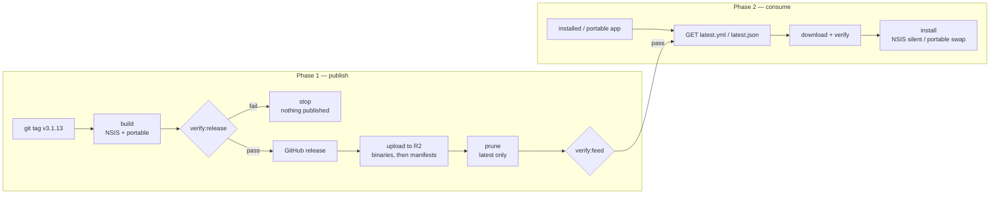

# Plan — automated updates

Two phases, one pipeline. Phase 1 is everything that gets a build into the
bucket; phase 2 is everything that gets it out of the bucket and onto a user's
machine. Neither phase is done until it has been run for real, not just built.



## Phase 1 — build → verify → R2

Status: **done — run `42621506954` went green from a tag push to `verify:feed`.**

| # | Step | Where | State |
|---|---|---|---|
| 1 | `v*` tag starts the build | `release.yml` | done |
| 2 | Missing feed credentials fail on step 1 | `release.yml` | done |
| 3 | Typecheck, lint, vitest, pytest must pass | `release.yml` | done |
| 4 | Pinned updater source must match `updater.lock.json` | `check-updater-lock.mjs` | done |
| 5 | Build the Python backend, Electron app, NSIS + portable | `release.yml` | done |
| 6 | `latest.yml` (electron-builder) + `latest.json` (portable) | `make-update-manifest.mjs` | done |
| 7 | Tag names the same version as `package.json` | `verify-release.mjs` | done |
| 8 | Packaged `app.asar` carries the live feed URL | `verify-release.mjs` | done |
| 9 | Both manifests match the files in `release/` byte for byte | `verify-release.mjs` | done |
| 10 | GitHub release: setup, blockmap, `latest.yml`, `latest.json` | `release.yml` | done |
| 11 | Upload binaries first, then manifests, with cache headers | `release.yml` | done |
| 12 | Prune everything outside the window, from the bucket's own listing | `prune-feed.mjs` | done |
| 13 | Read the public feed back: version, sizes, headers, leftovers, and (with `--download`) the portable's sha256 | `verify-feed.mjs` | done |
| 14 | `CLOUDFLARE_API_TOKEN` repo secret | GitHub settings | done |
| 15 | First end-to-end run | Actions | **done — `42621506954`, green** |

Phase 1 is done when a tag push produces a run that goes green and leaves the
bucket serving exactly that version, with no manual step.

### Notes from building it

- `verify:release` runs before **anything** is published. A manifest naming a
  file that does not exist, a stale hash, or an unre-pinned updater change stops
  the run while the bucket is still untouched.
- `verify:feed` runs after the upload and reads the public URL. It is the only
  check that proves the upload worked rather than assuming it.
- Prune now lists the bucket through the R2 API instead of guessing names from
  tags. `3.1.11` and `3.1.12` were never tagged, so tag-based pruning would
  have left `3.1.12` in the bucket after `3.1.13` published.
- A tag has to be cut **after** the release tooling it runs: the first 3.1.13
  attempt checked out a tag that predated `verify:feed` and died with
  `npm error Missing script: "verify:feed"` after it had already uploaded. The
  fix was a new tag, not a re-run: a re-run checks out the same old tree.
- The run also archived the whole `release/` folder as a workflow artifact and
  hit the account's artifact quota. Removed: the GitHub release and the bucket
  already hold everything it archived.

## Phase 2 — R2 → app → install

Status: **code complete; one manual install on this machine, then the live
tests.**

| # | Step | Where | State |
|---|---|---|---|
| 0 | A build ≤ 3.1.10 still asks GitHub and 404s on a private repo: install 3.1.15 by hand once | manual | **pending — this machine runs 3.1.10** |
| 1 | One feed URL constant, overridable for local tests | `src/main/updateFeed.ts` | done |
| 2 | Installed: `electron-updater` against the generic provider | `src/main/updater.ts` | done |
| 3 | Installed: check at startup, then every 4 h | `src/main/updater.ts` | done |
| 4 | Installed: auto-download, hash check by electron-updater, silent quit-and-install | `src/main/updater.ts` | done |
| 5 | Portable: read `latest.json` | `src/main/portableUpdate.ts` | done |
| 6 | Portable: download, verify sha256 + size, delete on mismatch | `src/main/portableUpdate.ts` | done |
| 7 | Portable: batch swap after exit, cleanup on next start | `src/main/portableUpdate.ts` | done |
| 8 | Renderer sees one `update:status` stream from both paths | `src/main/*` | done |
| 9 | Live portable update `3.1.15 → next` | manual | pending |
| 10 | Live installed (NSIS) update `3.1.15 → next` | manual | pending |
| 11 | Failure modes on the real feed: offline, 404, corrupt download | manual | pending |

Phase 2 is done when a published release updates both build types without a
prompt, a re-download, or a leftover file.

### Why one install has to be manual

`updateFeed.ts` and `portableUpdate.ts` first shipped in `e3a083f` (09:00
today), after the 3.1.10 build. A 3.1.10 install still carries
`app-update.yml` with `provider: github` and asks
`https://github.com/yassine808/assist/releases.atom`, which answers 404 because
the repository is private. The log on this machine shows exactly that, four
times, at every start:

```
[info]  Checking for update
[error] Auto-updater error: HttpError: 404
  "method: GET url: https://github.com/yassine808/assist/releases.atom"
```

Nothing published can reach a client that does not know the feed exists, so
3.1.10 → 3.1.15 is one manual install. Every release after that updates itself.

The address those old clients ask for is now a public repository:
`yassine808/assist` carries a `v3.1.8` release (installer + `latest.yml`, no
portable), so a 3.1.8 install stops failing with 404. It still reports "up to
date" — moving those installs forward needs a release **newer than 3.1.8** in
that repository.

## Decisions already made

| Decision | Why |
|---|---|
| Bucket holds the **three newest versions** | the last three builds are always downloadable, so a rollback needs no rebuild; `--keep N` changes the window |
| Binaries before manifests, never the reverse | a client must never read a manifest that names a file the bucket does not have |
| Binaries `immutable`, manifests `no-cache` | a version's bytes never change; the pointer must be revalidated or releases stay invisible |
| Feed is the only update source | the repo is private, so a GitHub release asset cannot be fetched by an installed copy |
| Portable builds re-download in full | they re-extract on every launch, so there is no stable file to delta against |
| No auto-tag on a version bump | a tag pushed by `GITHUB_TOKEN` does not trigger another workflow; it needs a PAT or `workflow_call` |

## Known limits

- `r2.dev` is Cloudflare's testing endpoint: it throttles at a few hundred
  requests/second. Fine at this scale; a custom domain removes it.
- Feed size: one version ≈ 265 MB, the free tier is 10 GB-month (~37 versions).
- Rollback needs the older version still in the bucket: `--keep N` first, then
  `withdraw.yml` repoints the manifests.

## Next action

Phase 2: install 3.1.15 once by hand — the 3.1.10 install cannot see the feed —
then publish the next release and watch both build types update themselves.
Portable first (no admin, full download), then the installed build (NSIS, block
delta). Both live tests need RiotSwitcher closed, so they wait for a moment
when VALORANT is not running.
