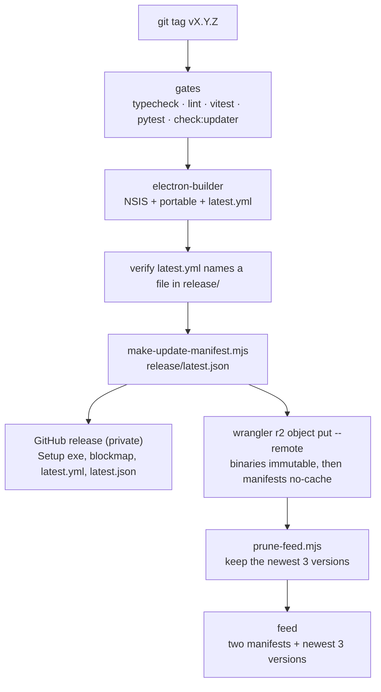
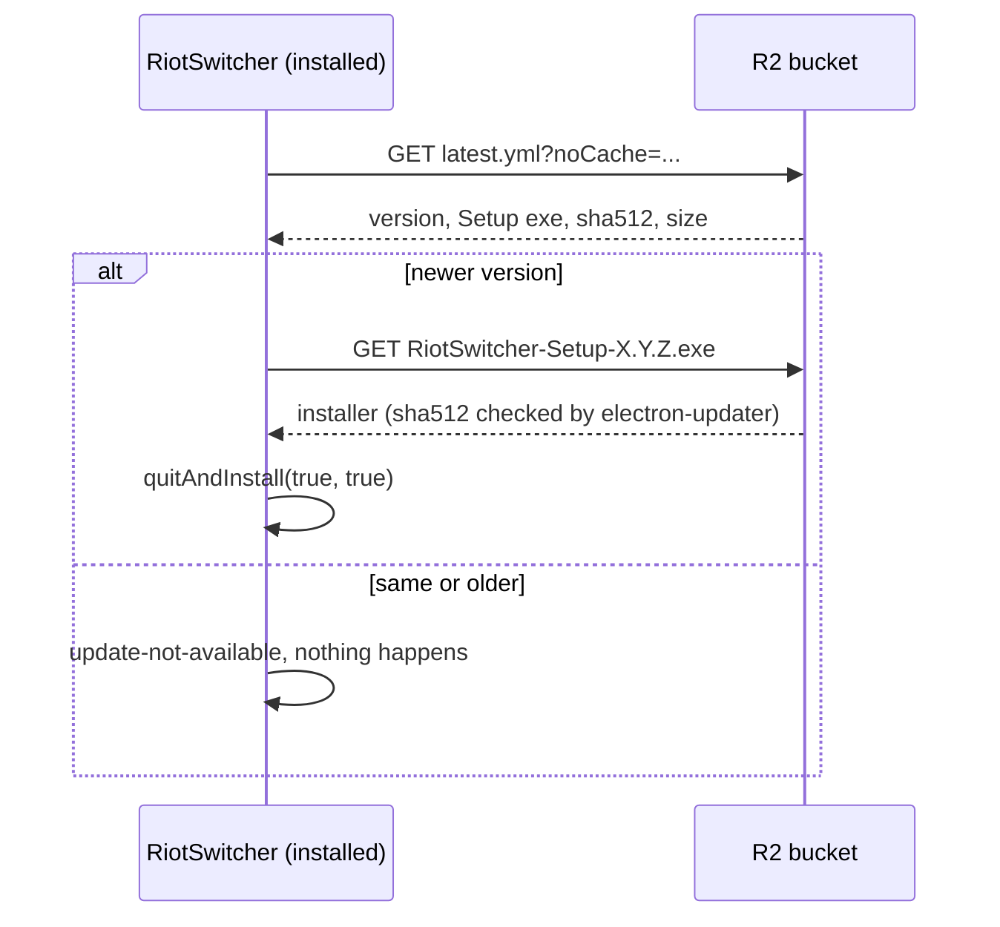
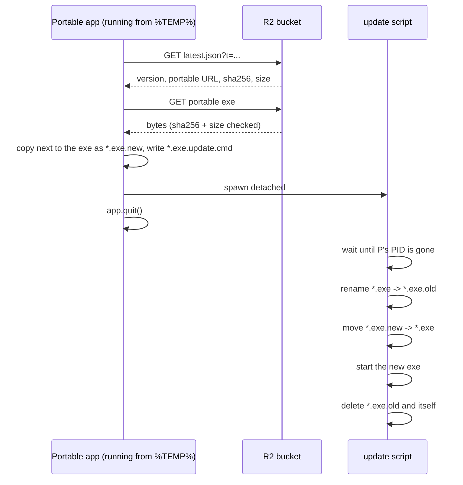

# Updates

RiotSwitcher ships two Windows artifacts, and each one updates itself:

| Artifact | Runs as | Updater |
| --- | --- | --- |
| `RiotSwitcher-Setup-<version>.exe` | installed app | `electron-updater` (`src/main/updater.ts`) |
| `RiotSwitcher-<version>-portable.exe` | unpacked into `%TEMP%`, no install | `src/main/portableUpdate.ts` |

Both read the same public feed. The feed is a Cloudflare R2 bucket because the
GitHub repository is private: release assets there need an authenticated
request, and neither an installed nor a portable copy has a token.

## 1. The bucket

| Setting | Value |
| --- | --- |
| Account ID | `d6e06264fb54c9b459f4d3975543474a` |
| Bucket | `riotswitcher-updates` |
| Public URL | `https://pub-6d3d6d22222242dab87967c474f39ada.r2.dev` |
| Access | public, `r2.dev` development URL |
| Cache | binaries `public, max-age=31536000, immutable`; manifests `no-cache` |

A versioned file never changes, so it is safe to cache forever; the two
manifests are pointers, so every reader revalidates them.

Created and opened once, from a shell logged into Cloudflare:

```powershell
wrangler login
wrangler r2 bucket create riotswitcher-updates
wrangler r2 bucket dev-url enable riotswitcher-updates
```

In the dashboard the same things live at **R2 → riotswitcher-updates**
(bucket, objects) and **R2 → riotswitcher-updates → Settings → Public access**
(the `r2.dev` toggle). No custom domain and no Worker: the bucket is read
anonymously over HTTPS.

The URL is stored in one place, `src/main/updateFeed.ts`. A local build can
point somewhere else without editing it:

```powershell
$env:RIOTSWITCHER_UPDATE_FEED = "http://127.0.0.1:8080"
```

## 2. What sits in the bucket

Everything is flat at the bucket root, because both manifests name files
relative to the feed URL.

```
riotswitcher-updates/
├── latest.yml                              NSIS manifest (electron-builder)
├── latest.json                             portable manifest (scripts/make-update-manifest.mjs)
├── RiotSwitcher-Setup-3.1.12.exe
├── RiotSwitcher-Setup-3.1.12.exe.blockmap
├── RiotSwitcher-3.1.12-portable.exe
├── RiotSwitcher-Setup-3.1.11.exe           previous releases, for rollback
├── RiotSwitcher-Setup-3.1.11.exe.blockmap
├── RiotSwitcher-3.1.11-portable.exe
└── …                                       newest three versions at most
```

The newest three versions stay, so a release that turns out to be bad can be
withdrawn without rebuilding it (see §7). After each publish,
`scripts/prune-feed.mjs` deletes the objects of every version older than that.

`latest.yml` is written by electron-builder for the installer. `latest.json`
is written after packaging for the portable build, which has no YAML parser:

```json
{
  "version": "3.1.11",
  "publishedAt": "2026-11-09T08:48:37.246Z",
  "files": {
    "portable": {
      "url": "https://pub-6d3d6d22222242dab87967c474f39ada.r2.dev/RiotSwitcher-3.1.11-portable.exe",
      "sha256": "…",
      "size": 126757669
    }
  }
}
```

## 3. Publishing



`release.yml` uploads in that order on purpose: a client must never read a
manifest that names a file the bucket does not have yet. The GitHub release
keeps the installer plus both manifests — the portables are delivered by the
feed — so a later withdrawal has everything it needs.

Before anything is published, `npm run verify:release`
(`scripts/verify-release.mjs`) checks the release as a whole:

| Check | Catches |
| --- | --- |
| pinned updater source still matches `updater.lock.json` | an uncommitted or unre-pinned change to `updater.ts` / `updateFeed.ts` / `portableUpdate.ts` |
| `app.asar` (or `out/main/index.js`) contains the feed URL | a packaged app built from an older tree |
| `latest.yml`: version, size, sha512, `path` | a manifest that names a file that is not in `release/`, or a stale hash |
| `latest.json`: version, url host, size, sha256 | the same for the portable exe |

Any failure exits non-zero and stops the run before GitHub or the bucket sees
anything. Run it locally the same way after `npm run build`.

The run stops on its first step while `CLOUDFLARE_API_TOKEN` or
`CLOUDFLARE_ACCOUNT_ID` is missing: a release that reaches GitHub but not the
feed leaves every installed copy on the old version, so failing loudly is the
only useful behaviour. Add both as repository secrets:

```powershell
gh secret set CLOUDFLARE_ACCOUNT_ID --body "d6e06264fb54c9b459f4d3975543474a"
gh secret set CLOUDFLARE_API_TOKEN   # paste the token at the prompt
```

Token: **My Profile → API Tokens → Create Token → Workers R2 Storage: Edit**.

With both set, publishing is one action — bump `version` in `package.json`,
commit, push a matching tag:

```powershell
git tag v3.1.13
git push origin v3.1.13
```

CI builds, uploads the binaries, then the manifests, then prunes everything
outside the retention window. No object is ever put into the bucket by hand.

By hand, from a logged-in shell, only if CI could not run:

```powershell
wrangler r2 object put "riotswitcher-updates/RiotSwitcher-3.1.12-portable.exe" --file release/RiotSwitcher-3.1.12-portable.exe --remote --cache-control "public, max-age=31536000, immutable"
wrangler r2 object put "riotswitcher-updates/RiotSwitcher-Setup-3.1.12.exe" --file release/RiotSwitcher-Setup-3.1.12.exe --remote --cache-control "public, max-age=31536000, immutable"
wrangler r2 object put "riotswitcher-updates/latest.json" --file release/latest.json --remote --content-type application/json --cache-control "no-cache"
wrangler r2 object put "riotswitcher-updates/latest.yml" --file release/latest.yml --remote --content-type text/yaml --cache-control "no-cache"
node scripts/prune-feed.mjs
```

## 4. Installed app



`initAutoUpdater()` calls
`autoUpdater.setFeedURL({ provider: "generic", url: UPDATE_FEED_URL })` before
the first check, which overrides the `publish` block baked into
`app-update.yml`. Check runs 5 s after the window opens, then every 4 hours.

## 5. Portable app

The portable exe unpacks into a per-launch `$PLUGINSDIR` and never installs
anything, so there is no installer to hand an update to. It replaces its own
exe instead:



Why a script: Windows keeps a running executable open, and the portable stub
*is* the file being replaced, so it cannot rename itself. The script waits for
the PID to exit, then swaps. It waits one extra second before starting the new
copy so the single-instance lock of the exiting process is released first.

Failure handling:

- Checksum or size mismatch → file deleted, `update:status: error`, app stays.
- Cannot write next to the exe → error event, nothing is renamed.
- Process dies mid-swap → next start finds `*.exe.old` without the new name
  and restores it (`cleanupPrevious`).
- Successful update → next start deletes the `.old`, `.new` and `.cmd`
  leftovers.

The renderer is unchanged: both updaters emit `update:status` with
`checking`, `available`, `downloading`, `downloaded`, `up-to-date` and `error`.

## 6. Verifying an update for real

1. Publish `3.1.11` (first build that contains the portable updater).
2. Publish `3.1.12`.
3. Close the installed app so it does not hold the single-instance lock.
4. Run `release\RiotSwitcher-3.1.11-portable.exe`.
5. Within ~5 s it reports the update, downloads it, and restarts itself.

Proof is the version shown in the app and in
`%APPDATA%\RiotSwitcher\logs\main.log`:

```
Portable update feed: https://pub-…r2.dev
```

then, after the restart, a `.old` file removed next to the exe and the app
reporting `3.1.12`.

## 7. Withdrawing a bad release

The newest three versions stay in the bucket for this. Repointing the manifests
at the previous version stops anyone new from installing the bad one — no
rebuild, no re-upload.

### From the Actions tab

**Actions → Withdraw → Run workflow**, with the version to fall back to. It runs
`.github/workflows/withdraw.yml`, which:

1. checks the input is `X.Y.Z`, both binaries are still in the feed, and the
   target really is **older** than what the feed serves now;
2. pulls that version's `latest.yml` and `latest.json` from its GitHub release
   (regenerating `latest.json` from the bucket if the release predates it);
3. overwrites the two manifests in the bucket with `no-cache`;
4. re-reads the feed and fails unless it now reports the older version.

`dry_run` defaults to **true**: the first run only prints the checks it would
perform. Clear it to actually write.

The workflow shares the `release-feed` concurrency group with `release.yml`, so
a withdrawal and a publish can never interleave on the manifests.

### By hand

```powershell
$v = "3.1.11"   # the version to go back to; it must still be in the bucket

# Both manifests are kept as assets of their GitHub release.
gh release download "v$v" -p latest.yml -O release/latest.yml
gh release download "v$v" -p latest.json -O release/latest.json

# Releases published before latest.json was stored there: rebuild it instead.
if (-not (Test-Path "release\latest.json")) {
  Invoke-WebRequest "https://pub-6d3d6d22222242dab87967c474f39ada.r2.dev/RiotSwitcher-$v-portable.exe" `
    -OutFile "release\RiotSwitcher-$v-portable.exe"
  node scripts/make-update-manifest.mjs --version $v
}

wrangler r2 object put "riotswitcher-updates/latest.yml"  --file release/latest.yml  --remote --content-type text/yaml --cache-control "no-cache"
wrangler r2 object put "riotswitcher-updates/latest.json" --file release/latest.json --remote --content-type application/json --cache-control "no-cache"
```

The binaries are already in the bucket under their versioned names, so the two
manifests are the only objects that change.

**This does not downgrade anyone.** Both updaters only move forward: a client
already on the bad version sees the older manifest as not newer and stays put.
Withdrawal limits the blast radius — new installs and clients that have not
checked yet land on the last good version. Repairing the clients already on the
bad one still needs a higher version number published normally.

## 8. Rules

- The updater modules are pinned (`scripts/check-updater-lock.mjs`): changing
  `updater.ts`, `updateFeed.ts` or `portableUpdate.ts` fails CI until the lock
  is re-pinned in the same commit.
- Never upload a manifest before its binary.
- `npm run verify:release` must pass before a release is published: it is the
  only check that looks at the packaged app and both manifests together.
- The bucket carries the newest three versions. `scripts/prune-feed.mjs`
  deletes everything older after the new manifests are live, never before;
  `--keep 1` restores the one-version behaviour.
- Binaries are published `immutable`, so a name must never change its bytes:
  the portable downloads by name, and a changed file under an old name would
  leave copies on different builds. Rebuild as a new version instead.
- The feed must stay anonymous. Anything that puts auth in front of the bucket
  breaks both updaters.
