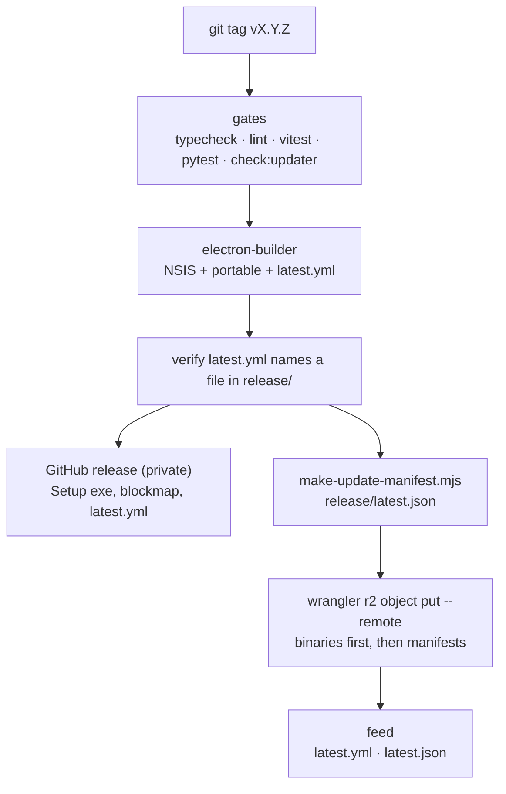
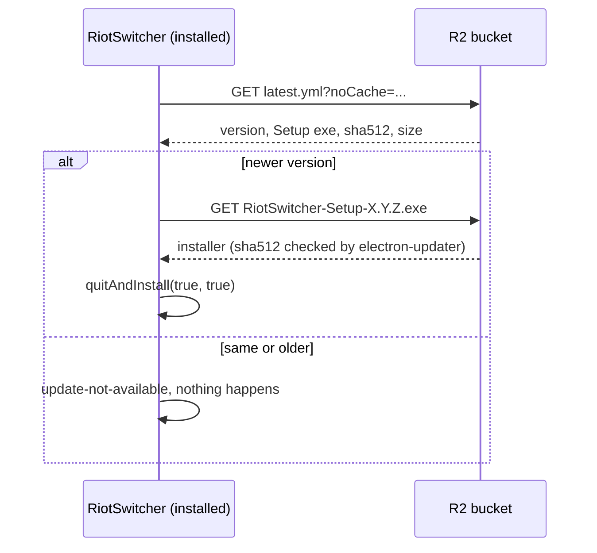
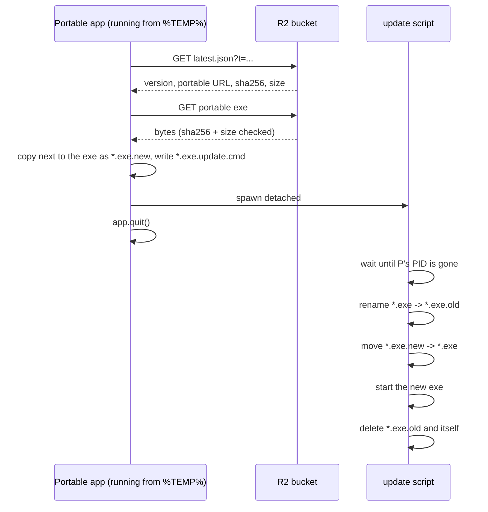

# Updates

RiotSwitcher ships two Windows artifacts, and each one updates itself:

| Artifact | Runs as | Updater |
| --- | --- | --- |
| `RiotSwitcher-Setup-<version>.exe` | installed app | `electron-updater` (`src/main/updater.ts`) |
| `RiotSwitcher-<version>-portable.exe` | unpacked into `%TEMP%`, no install | `src/main/portableUpdate.ts` |

Both read the same public feed. The feed is a Cloudflare R2 bucket because the
GitHub repository is private: release assets there need an authenticated
request, and neither an installed nor a portable copy has a token.

## 1. The bucket

| Setting | Value |
| --- | --- |
| Account ID | `d6e06264fb54c9b459f4d3975543474a` |
| Bucket | `riotswitcher-updates` |
| Public URL | `https://pub-6d3d6d22222242dab87967c474f39ada.r2.dev` |
| Access | public, `r2.dev` development URL |
| Cache | default; manifests are requested with a cache-busting query |

Created and opened once, from a shell logged into Cloudflare:

```powershell
wrangler login
wrangler r2 bucket create riotswitcher-updates
wrangler r2 bucket dev-url enable riotswitcher-updates
```

In the dashboard the same things live at **R2 → riotswitcher-updates**
(bucket, objects) and **R2 → riotswitcher-updates → Settings → Public access**
(the `r2.dev` toggle). No custom domain and no Worker: the bucket is read
anonymously over HTTPS.

The URL is stored in one place, `src/main/updateFeed.ts`. A local build can
point somewhere else without editing it:

```powershell
$env:RIOTSWITCHER_UPDATE_FEED = "http://127.0.0.1:8080"
```

## 2. What sits in the bucket

Everything is flat at the bucket root, because both manifests name files
relative to the feed URL.

```
riotswitcher-updates/
├── latest.yml                              NSIS manifest (electron-builder)
├── latest.json                             portable manifest (scripts/make-update-manifest.mjs)
├── RiotSwitcher-Setup-3.1.11.exe
├── RiotSwitcher-Setup-3.1.11.exe.blockmap
└── RiotSwitcher-3.1.11-portable.exe
```

`latest.yml` is written by electron-builder for the installer. `latest.json`
is written after packaging for the portable build, which has no YAML parser:

```json
{
  "version": "3.1.11",
  "publishedAt": "2026-11-09T08:48:37.246Z",
  "files": {
    "portable": {
      "url": "https://pub-6d3d6d22222242dab87967c474f39ada.r2.dev/RiotSwitcher-3.1.11-portable.exe",
      "sha256": "…",
      "size": 126757669
    }
  }
}
```

## 3. Publishing



`release.yml` uploads in that order on purpose: a client must never read a
manifest that names a file the bucket does not have yet. The GitHub release
gets the installer only; portables are delivered by the feed.

Uploads are skipped while `CLOUDFLARE_API_TOKEN` and `CLOUDFLARE_ACCOUNT_ID`
are empty, so a release still publishes on GitHub without them. Add both as
repository secrets (token scope: *Workers R2 Storage: Edit*) to let CI fill
the bucket.

By hand, from a logged-in shell:

```powershell
wrangler r2 object put "riotswitcher-updates/RiotSwitcher-3.1.11-portable.exe" --file release/RiotSwitcher-3.1.11-portable.exe --remote
wrangler r2 object put "riotswitcher-updates/latest.json" --file release/latest.json --remote --content-type application/json
```

## 4. Installed app



`initAutoUpdater()` calls
`autoUpdater.setFeedURL({ provider: "generic", url: UPDATE_FEED_URL })` before
the first check, which overrides the `publish` block baked into
`app-update.yml`. Check runs 5 s after the window opens, then every 4 hours.

## 5. Portable app

The portable exe unpacks into a per-launch `$PLUGINSDIR` and never installs
anything, so there is no installer to hand an update to. It replaces its own
exe instead:



Why a script: Windows keeps a running executable open, and the portable stub
*is* the file being replaced, so it cannot rename itself. The script waits for
the PID to exit, then swaps. It waits one extra second before starting the new
copy so the single-instance lock of the exiting process is released first.

Failure handling:

- Checksum or size mismatch → file deleted, `update:status: error`, app stays.
- Cannot write next to the exe → error event, nothing is renamed.
- Process dies mid-swap → next start finds `*.exe.old` without the new name
  and restores it (`cleanupPrevious`).
- Successful update → next start deletes the `.old`, `.new` and `.cmd`
  leftovers.

The renderer is unchanged: both updaters emit `update:status` with
`checking`, `available`, `downloading`, `downloaded`, `up-to-date` and `error`.

## 6. Verifying an update for real

1. Publish `3.1.11` (first build that contains the portable updater).
2. Publish `3.1.12`.
3. Close the installed app so it does not hold the single-instance lock.
4. Run `release\RiotSwitcher-3.1.11-portable.exe`.
5. Within ~5 s it reports the update, downloads it, and restarts itself.

Proof is the version shown in the app and in
`%APPDATA%\RiotSwitcher\logs\main.log`:

```
Portable update feed: https://pub-…r2.dev
```

then, after the restart, a `.old` file removed next to the exe and the app
reporting `3.1.12`.

## 7. Rules

- The updater modules are pinned (`scripts/check-updater-lock.mjs`): changing
  `updater.ts`, `updateFeed.ts` or `portableUpdate.ts` fails CI until the lock
  is re-pinned in the same commit.
- Never upload a manifest before its binary.
- Never rebuild an existing version: the portable downloads by name and a
  changed file under an old name would leave copies on different builds.
- The feed must stay anonymous. Anything that puts auth in front of the bucket
  breaks both updaters.
