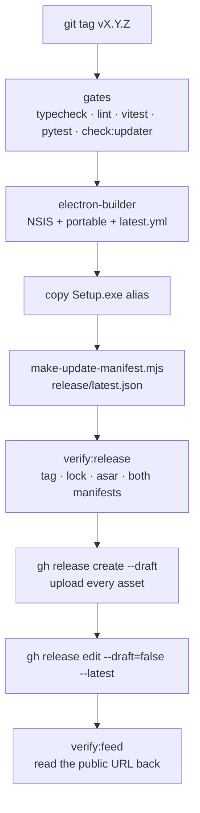
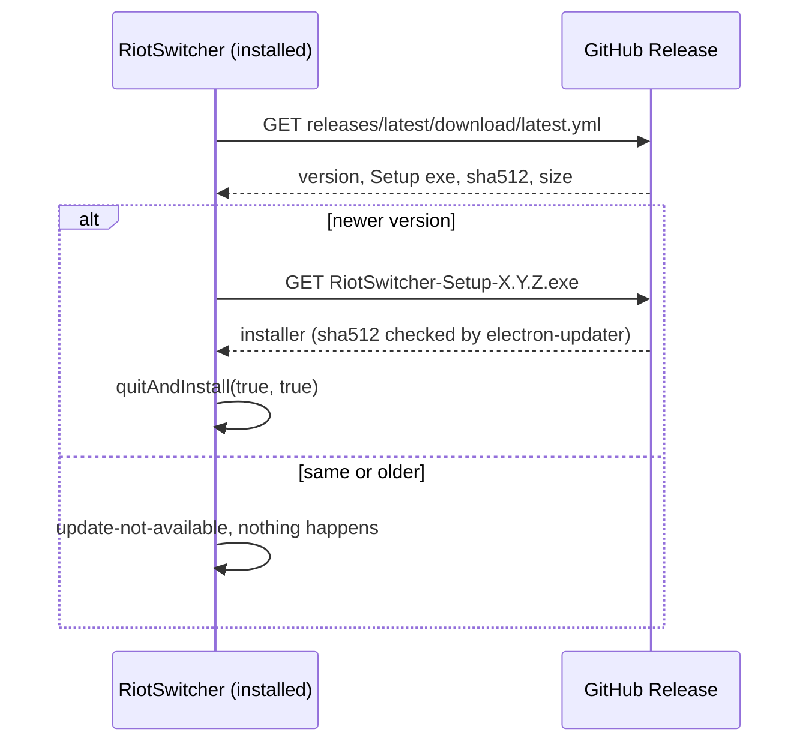
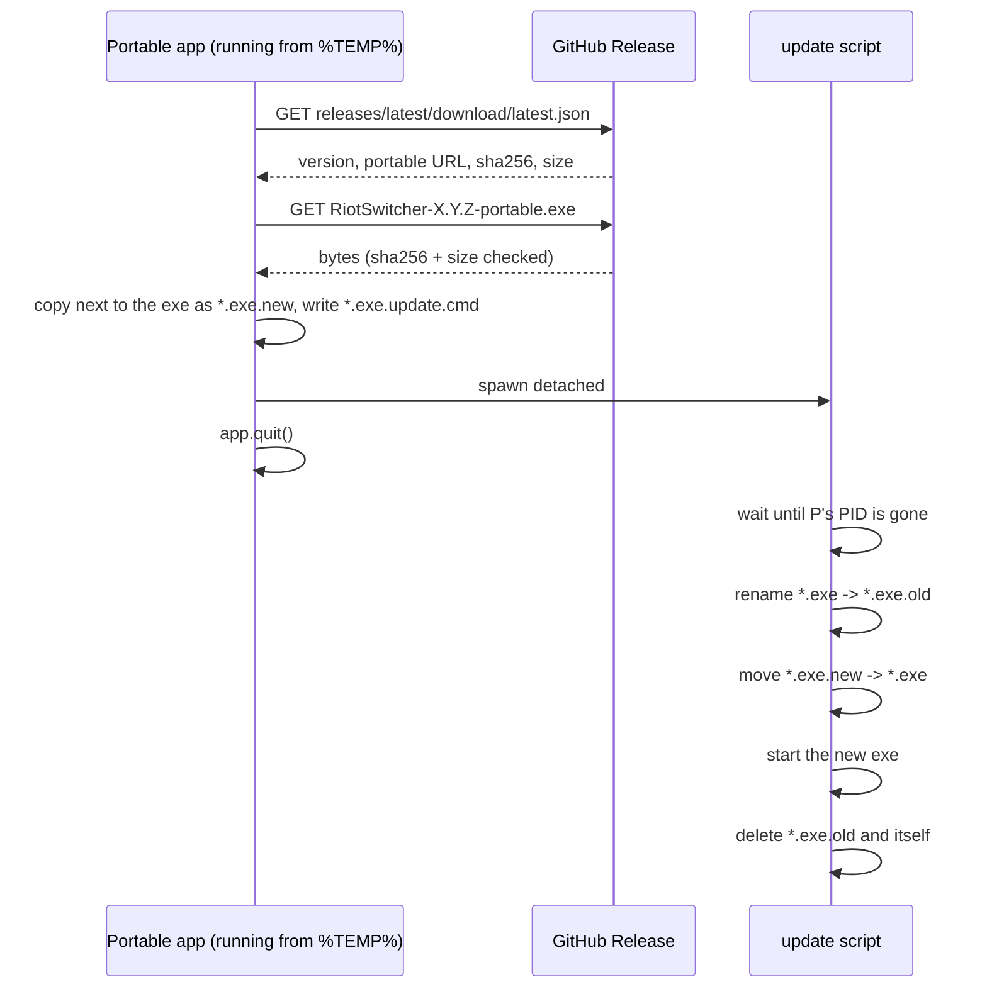

# Updates

RiotSwitcher ships two Windows artifacts, and each one updates itself:

| Artifact | Runs as | Updater |
| --- | --- | --- |
| `RiotSwitcher-Setup-<version>.exe` | installed app | `electron-updater` (`src/main/updater.ts`) |
| `RiotSwitcher-<version>-portable.exe` | unpacked into `%TEMP%`, no install | `src/main/portableUpdate.ts` |

Both read the same public feed: the newest **GitHub Release** of
`yassine808/RiotSwitcher`. The repository is public, so GitHub serves release
assets anonymously and no token ships in the app.

```
https://github.com/yassine808/RiotSwitcher/releases/latest/download
```

## 1. The feed

`releases/latest/download` is a flat view of the release GitHub currently marks
as **Latest**: every asset can be fetched by name from that one base. That is
exactly the layout both updaters expect, so no bucket, CDN or Worker is
involved.

The URL lives in one place, `src/main/updateFeed.ts`. A local build can point
somewhere else without editing it:

```powershell
$env:RIOTSWITCHER_UPDATE_FEED = "http://127.0.0.1:8080"
```

`release.yml` publishes a release with `gh release edit --latest`, and
`withdraw.yml` moves that same pointer back to an older release (§7). Nothing
else decides what "latest" means.

## 2. What a release contains

Everything is flat inside the release, because both manifests name files
relative to the feed URL.

```
v3.1.24/
├── latest.yml                              NSIS manifest (electron-builder)
├── latest.json                             portable manifest (scripts/make-update-manifest.mjs)
├── RiotSwitcher-Setup-3.1.24.exe
├── RiotSwitcher-Setup-3.1.24.exe.blockmap
├── RiotSwitcher-Setup.exe                  stable alias used by README
└── RiotSwitcher-3.1.24-portable.exe
```

`latest.yml` is written by electron-builder for the installer. `latest.json`
is written after packaging for the portable build, which has no YAML parser:

```json
{
  "version": "3.1.24",
  "publishedAt": "2026-11-27T09:00:00.000Z",
  "files": {
    "portable": {
      "url": "https://github.com/yassine808/RiotSwitcher/releases/latest/download/RiotSwitcher-3.1.24-portable.exe",
      "sha256": "…",
      "size": 126757669
    }
  }
}
```

Releases are never pruned. Older releases stay downloadable for rollback and
for the withdrawal workflow, but the feed only ever serves the newest one.

## 3. Publishing



The draft is deliberate: the latest pointer must never expose a release whose
assets are still uploading. Every file a client can request is in the release
before it becomes public.

Before anything is published, `npm run verify:release`
(`scripts/verify-release.mjs`) checks the release as a whole:

| Check | Catches |
| --- | --- |
| tag vs `package.json` version | a release named `v3.1.13` that contains a `3.1.12` build |
| pinned updater source still matches `updater.lock.json` | an uncommitted or un-re-pinned change to `updater.ts` / `updateFeed.ts` / `portableUpdate.ts` |
| `app.asar` (or `out/main/index.js`) contains the feed URL | a packaged app built from an older tree |
| `latest.yml`: version, size, sha512, `path` | a manifest that names a file that is not in `release/`, or a stale hash |
| `latest.json`: version, url host, size, sha256 | the same for the portable exe |

Any failure exits non-zero and stops the run before GitHub sees anything. Run it
locally the same way after `npm run build`; `--tag vX.Y.Z` (or `RELEASE_TAG`)
adds the tag check.

After the release is public, `npm run verify:feed` (`scripts/verify-feed.mjs`)
reads the public URL the way a client does: both manifests report this version,
the binaries behind them answer 200 with the declared size, and the portable
URL is on the feed. The release run sets `VERIFY_DOWNLOAD=1`, which also
downloads the portable once and checks its sha256 — the only check that covers
the bytes a client installs, since a corrupt asset passes every HEAD check and
is refused by the client only after the full download.

Publishing is one action — bump `version` in `package.json`, commit, push a
matching tag:

```powershell
git tag v3.1.24
git push origin v3.1.24
```

No repository secret is needed: `GITHUB_TOKEN` is provided by Actions, and the
repository is public. By hand, only if CI could not run:

```powershell
$tag = "v3.1.24"
gh release create $tag --draft --verify-tag --title "RiotSwitcher $tag" --generate-notes
gh release upload $tag release/*.exe release/*.blockmap release/latest.yml release/latest.json
gh release edit $tag --draft=false --latest
npm run verify:feed
```

## 4. Installed app



`initAutoUpdater()` calls
`autoUpdater.setFeedURL({ provider: "generic", url: UPDATE_FEED_URL })` before
the first check, which overrides the `publish` block baked into
`app-update.yml`. Check runs 5 s after the window opens, then every 4 hours.

## 5. Portable app

The portable exe unpacks into a per-launch `$PLUGINSDIR` and never installs
anything, so there is no installer to hand an update to. It replaces its own
exe instead:



Why a script: Windows keeps a running executable open, and the portable stub
*is* the file being replaced, so it cannot rename itself. The script waits for
the PID to exit, then swaps. It waits one extra second before starting the new
copy so the single-instance lock of the exiting process is released first.

Failure handling — the rule is the same for both builds: say which step
failed and why, then close the app.

- Checksum or size mismatch → file deleted, error message, app closes.
- Cannot write next to the exe → error message, nothing is renamed, app closes.
- Process dies mid-swap → next start finds `*.exe.old` without the new name
  and restores it (`cleanupPrevious`), reports it, and closes.
- Successful update → next start deletes the `.old`, `.new` and `.cmd`
  leftovers.

The renderer is unchanged: both updaters emit `update:status` with
`checking`, `available`, `downloading`, `downloaded`, `up-to-date` and `error`.

## 6. Verifying an update for real

1. Publish `3.1.24`.
2. Publish `3.1.25`.
3. Close the installed app so it does not hold the single-instance lock.
4. Run `release\RiotSwitcher-3.1.24-portable.exe`.
5. Within ~5 s it reports the update, downloads it, and restarts itself.

Proof is the version shown in the app and in
`%APPDATA%\RiotSwitcher\logs\main.log`:

```
Portable update feed: https://github.com/yassine808/RiotSwitcher/releases/latest/download
```

then, after the restart, a `.old` file removed next to the exe and the app
reporting `3.1.25`. The installed build logs
`Update feed: https://github.com/yassine808/RiotSwitcher/releases/latest/download`
and restarts into the new installer the same way.

## 7. Withdrawing a bad release

The target release must still exist and be public. `withdraw.yml` does not
rebuild anything: it moves GitHub's **Latest** pointer back, and
`releases/latest/download` immediately serves that release's manifests and
binaries again.

### From the Actions tab

**Actions → Withdraw → Run workflow**, with the version to fall back to. It:

1. checks the input is `X.Y.Z`, the release is public and carries both
   manifests and both binaries, and the target really is **older** than the
   current latest release;
2. runs `gh release edit vX.Y.Z --latest`;
3. re-reads `releases/latest/download/latest.json` and `latest.yml` and fails
   unless they now report the older version.

`dry_run` defaults to **true**: the first run only prints the checks it would
perform. Clear it to actually move the pointer.

The workflow shares the `release-feed` concurrency group with `release.yml`, so
a withdrawal and a publish can never interleave on the pointer.

### By hand

```powershell
gh release edit v3.1.23 --latest
npm run verify:feed -- --version 3.1.23
```

**This does not downgrade anyone.** Both updaters only move forward: a client
already on the bad version sees the older manifest as not newer and stays put.
Withdrawal limits the blast radius — new installs and clients that have not
checked yet land on the last good version. Repairing the clients already on the
bad one still needs a higher version number published normally.

## 8. Migrating installs from the old R2 feed (one time)

Builds up to `3.1.23` were published while the repository was private, so they
read the old Cloudflare R2 bucket. They cannot see GitHub on their own. To move
them:

1. Publish the first GitHub release (`3.1.24` or later) normally.
2. Put that release's two manifests into the old bucket, with the installer
   and portable URLs pointing at **GitHub**. `latest.json` already contains an
   absolute GitHub URL; `latest.yml` needs its relative names made absolute:

   ```powershell
   $v = "3.1.24"
   $tag = "v$v"
   $base = "https://github.com/yassine808/RiotSwitcher/releases/download/$tag"
   gh release download $tag -p latest.yml -p latest.json -D release/legacy
   node -e "const fs=require('fs');const base=process.argv[1];let y=fs.readFileSync('release/legacy/latest.yml','utf8');y=y.replace(/(\s-\surl:\s*)(\S+)/g,(m,p,u)=>p+base+'/'+u).replace(/^path:\s*(\S+)/m,(m,p)=>'path: '+base+'/'+p);fs.writeFileSync('release/legacy/latest.yml',y);" $base
   ```

3. Upload only those two manifests to the old bucket, with `no-cache`:

   ```powershell
   wrangler r2 object put "riotswitcher-updates/latest.yml"  --file release/legacy/latest.yml  --remote --content-type text/yaml --cache-control "no-cache"
   wrangler r2 object put "riotswitcher-updates/latest.json" --file release/legacy/latest.json --remote --content-type application/json --cache-control "no-cache"
   ```

Old clients read the R2 manifests, see the new version, download the installer
or portable **from GitHub**, and from that version on they read GitHub directly.
After this one-time bridge, R2 is no longer part of the update path and the
Cloudflare credentials can be removed from the repository secrets.

## 9. Rules

- The updater modules are pinned (`scripts/updater.lock.json`): changing
  `updater.ts`, `updateFeed.ts` or `portableUpdate.ts` fails CI until the lock
  is re-pinned in the same commit.
- `npm run check:updater` (`scripts/check-updater.mjs`) is the full gate: lock,
  GitHub feed URL, both electron-builder targets, every updater event, the IPC
  routing, the release workflow, and a scan that no release path still talks to
  Cloudflare. CI runs it on every change; the release runs it again.
- Never publish a manifest before its binary. `release.yml` creates a draft,
  uploads everything, then publishes.
- `npm run verify:release` must pass before a release is published: it is the
  only check that looks at the packaged app and both manifests together.
- Binaries keep versioned names and never change their bytes. Rebuild as a new
  version instead.
- The feed must stay anonymous. Making the repository private again breaks both
  updaters, because neither ships a GitHub token.
